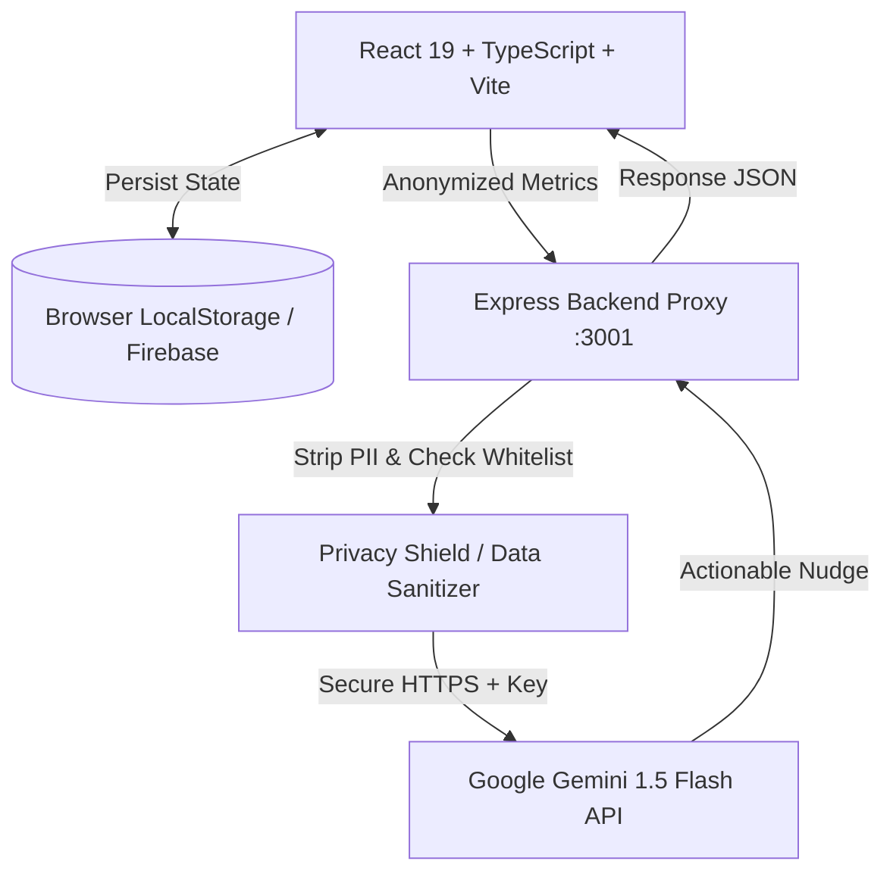

# TradeGuard AI 🛡️📈

> **Your Trading Copilot — Real-Time Risk & Behavior Guard for Leveraged Trading**  
> *A real-time safety layer that intervenes BEFORE a leveraged trade happens — not after the trader regrets it.*

[](https://react.dev/)
[](https://www.typescriptlang.org/)
[](https://vitejs.dev/)
[](https://tailwindcss.com/)
[](https://expressjs.com/)
[](https://ai.google.dev/)

---

## 🏆 Project Overview

**TradeGuard AI** is built for the **Mochatrade YC P26 Hackathon (FinTech Track)** by **Team ElectroCode** (University of Mumbai).

Retail traders in leveraged crypto and derivatives markets regularly suffer catastrophic account drawdowns due to emotional trading, high leverage compounding, and revenge trading spirals. Traditional platforms only report damage *after* liquidation occurs.

**TradeGuard AI** acts as a pre-trade circuit breaker and psychological safety guard, analyzing risk factors and behavioral anomalies in real-time before an order is placed.

---

## ⚡ Core Features

### 1. 🔍 Pre-Trade Risk Engine
- Deterministic multi-factor risk scoring algorithm (0–100 scale).
- Evaluates:
  - **Leverage Multiplier Risk** (Normalized weight: 40%)
  - **Position Exposure vs. Account Capital** (Normalized weight: 30%)
  - **Asset Volatility Profile** (LOW / MEDIUM / HIGH: 20%)
  - **Loss Streak Risk** (Active streak multiplier: 10%)
- Categorizes risk severity into **LOW**, **MODERATE**, **HIGH**, and **CRITICAL** tiers.

### 2. 🚨 Revenge Trading Detection Layer
- Real-time heuristic behavioral surveillance:
  - Detects rapid re-entries (< 10 minutes from last loss).
  - Identifies position size escalation (> 50% increase over recent average size).
  - Flags emotional over-leveraging attempts after drawdown sequences.

### 3. 🤖 AI Risk Co-Pilot (Gemini 1.5 Flash)
- Provides contextual, actionable natural language risk nudges.
- Explains why a trade is dangerous before commitment.
- Generates periodic behavioral discipline reviews without making ungrounded assumptions.

### 4. 🔒 Privacy Shield & Data Minimization Architecture
- **Strict Server-Side Key Management**: `GEMINI_API_KEY` is loaded exclusively by the Express backend and is never exposed to the client or browser network logs.
- **Zero PII Transmission**: User identity, email, account identifiers, and raw transaction logs are stripped before reaching the AI.
- **Anonymized Metrics Whitelist**: Only anonymized computed values (e.g. `riskScore`, `leverage`, `lossStreak`) are passed to Gemini.

### 5. 📊 Trading Health & Discipline Report
- Focuses on **Behavioral Discipline**, not raw P&L.
- Rewards risk mitigation (cancelling dangerous trades gives positive points).
- Penalizes rule breaches, revenge trading triggers, and excessive leverage violations.
- Assigns objective letter grades (A+ to F).

### 6. 🎨 Production-Grade FinTech UI & Dark/Light Themes
- Built with a sleek dark navy institutional trading interface.
- Native Light Theme toggle that overrides CSS styles smoothly.
- Tabbed settings dashboard with simulated profile management, notification toggles, data export, and ledger reset modals.

---

## 🛠️ Architecture & Tech Stack



- **Frontend**: React 19, TypeScript, Vite, Tailwind CSS v4, Lucide React
- **Backend**: Node.js, Express, TypeScript (`ts-node`)
- **AI Service**: Google Gemini API via official REST endpoints
- **Database Wrapper**: Dual-mode engine supporting LocalStorage sandbox with Firebase Cloud Firestore readiness

---

## 🚀 Quick Start & Setup

### Prerequisites
- [Node.js](https://nodejs.org/) (v18 or higher recommended)
- `npm` (v9 or higher)
- A Google Gemini API Key from [Google AI Studio](https://aistudio.google.com/)

### 1. Clone the Repository
```bash
git clone https://github.com/<YOUR_USERNAME>/tradeguard-ai.git
cd tradeguard-ai
```

### 2. Install Dependencies
```bash
npm install
```

### 3. Configure Environment Variables
Copy `.env.example` to `.env`:
```bash
cp .env.example .env
```
Edit `.env` and provide your Gemini API Key:
```env
GEMINI_API_KEY=your_gemini_api_key_here
```

### 4. Run the Full Application (Frontend + Backend)
```bash
npm run dev:full
```
This runs concurrently:
- **Express Backend API**: `http://localhost:3001`
- **Vite React Frontend**: `http://localhost:5173`

---

## 📜 Available Scripts

| Command | Description |
| :--- | :--- |
| `npm run dev:full` | Starts both Express backend and Vite frontend concurrently |
| `npm run dev` | Starts only the Vite frontend dev server |
| `npm run server` | Starts only the Express backend server (`ts-node`) |
| `npm run build` | Builds production bundle for frontend (`tsc -b && vite build`) |
| `npm run preview` | Previews the production build locally |

---

## 🛡️ Privacy & Security Design

TradeGuard AI follows strict data minimization principles:
- The browser **never** talks to Google Gemini directly.
- The backend sanitization layer strips all non-whitelisted parameters:
  ```json
  // Whitelist of allowed metrics for AI explanation:
  [
    "riskScore", "riskLevel", "leverage", "positionExposurePercentage",
    "volatilityScore", "lossStreak", "revengeTradingDetected",
    "recentTradeCount", "proposedTradeSize", "averagePreviousTradeSize"
  ]
  ```
- Personal profile names, emails, and exact timestamps are **never** forwarded to Gemini.

---

## 👥 Team ElectroCode

Developed for **Mochatrade YC P26 Hackathon — FinTech Track**:

- **Abhishek Gupta**
- **Akash Yadav**
- **Nitin Chaurasiya**

🏛️ **University of Mumbai**

---

## 📄 License
This project is licensed under the [MIT License](LICENSE).
